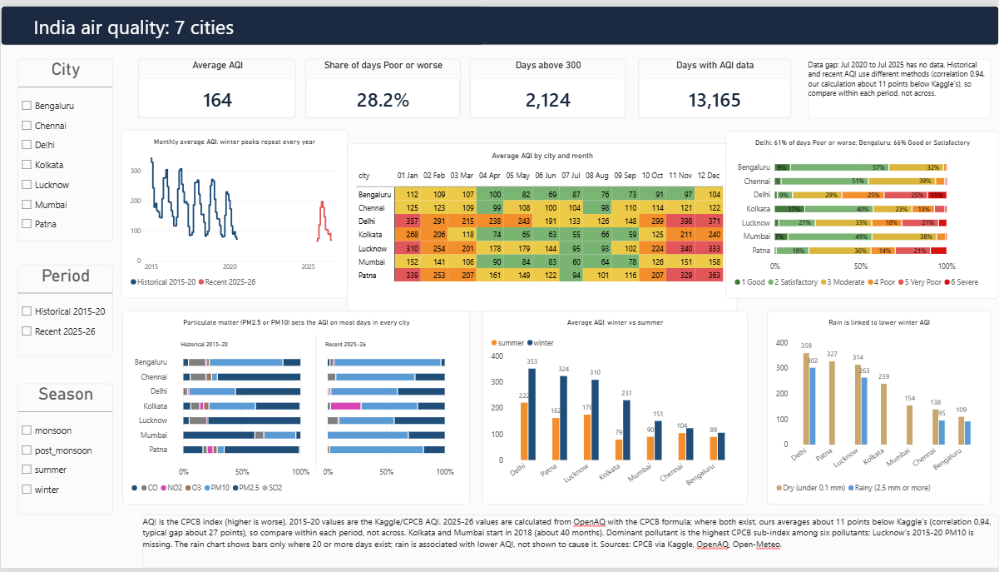
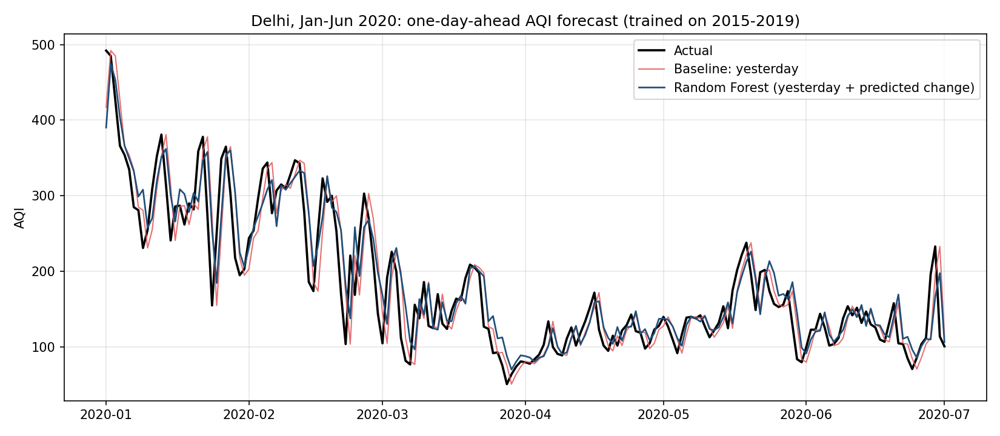
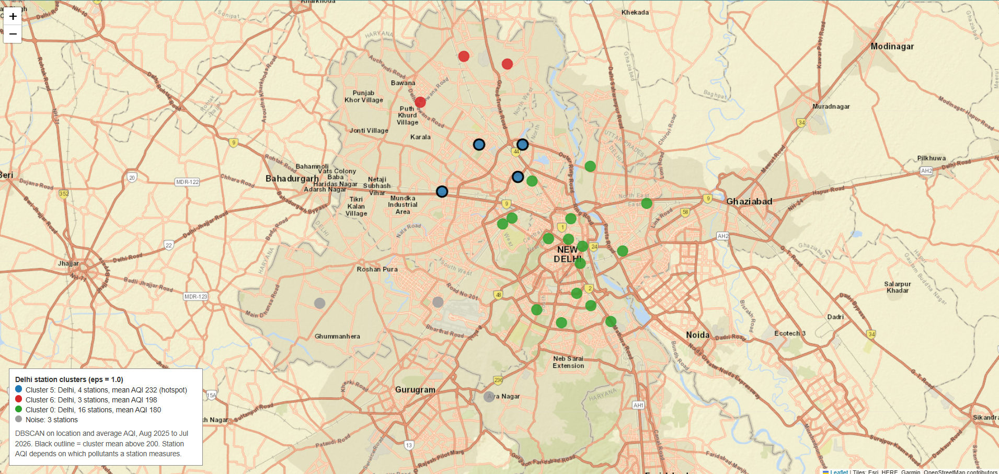

# India air quality analysis: 7 cities, 2015-2026

An end-to-end analysis of daily AQI in Bengaluru, Chennai, Delhi, Kolkata, Lucknow, Mumbai and Patna. It merges CPCB data (2015-2020) with OpenAQ readings (2025-26) and weather, answers questions in pandas and SQL, and presents the results in a one-page Power BI dashboard.



## Key findings

- **Winter dominates.** Winter average AQI is 2.9x summer in Kolkata and 2.0x in Patna, against about 1.2x in Chennai and Bengaluru. Kolkata's 2.9x rests on about 40 months of data.
- **Delhi is the worst city.** 61% of its days are Poor, Very Poor or Severe; Bengaluru has 66% Good or Satisfactory days.
- **Delhi's days above 300** fell from 50% (2015) to 26% (2019) in the historical data.
- **Particulate matter sets the AQI** on most days in every city (PM2.5 or PM10 together about 72% or more).
- **Rain is associated with lower winter AQI** in Chennai, Bengaluru, Delhi and Lucknow (the cities with 20+ rainy winter days). This is an association, not proof of cause.
- **No weekday effect:** daily AQI varies by under 2% across weekdays.

## Data

| Source | Period | Used for |
|---|---|---|
| CPCB via Kaggle (`city_day`) | 2015-01-01 to 2020-07-01 | Historical AQI and pollutants |
| OpenAQ | 2025-08-01 to 2026-08-10 | Recent pollutants (AQI computed here) |
| Open-Meteo | both periods | Temperature, rain, wind, humidity |

There is no data between July 2020 and July 2025. Details, cleaning rules and corrections are in [`data/README.md`](data/README.md).

## Method

1. Standardise city names, parse dates, and handle missing data (40% threshold, measured from each station's first reading; short gaps forward-filled).
2. Pivot OpenAQ to one row per city-day, remove sensor errors, and compute AQI with the CPCB breakpoint formula (`src/aqi_calculator.py`).
3. Merge pollutants with weather (lossless for the 7 cities) and save `data/processed/aqi_weather_master.csv`.
4. Analyse in pandas (`reports/figures/`) and SQLite (`sql/`).
5. Build the Power BI dashboard (`dashboard/`).

## SQL queries

| File | Question |
|---|---|
| `sql/01_worst_months.sql` | Worst 5 months per city |
| `sql/02_days_above_300.sql` | Days above AQI 300 per year |
| `sql/03_winter_summer_ratio.sql` | Winter vs summer AQI |
| `sql/04_days_by_category.sql` | Days per CPCB category |
| `sql/05_rain_vs_dry_winter.sql` | Rainy vs dry winter days |

## Dashboard

[Delhi view](reports/screenshots/dashboard_delhi.png) | [Bengaluru view](reports/screenshots/dashboard_bengaluru.png)

## Limitations

- **The two AQI sources differ.** Historical AQI is Kaggle's. Recent AQI is calculated here. On 10,674 overlapping historical days our calculation is about 11 points lower on average (correlation 0.94, typical gap about 27 points). Compare within each period, not across.
- **Kolkata and Mumbai start in 2018**, so their trends are thin.
- **Dominant pollutant** is the highest CPCB sub-index among six pollutants, not the official driver.
- Lucknow has no 2015-20 PM10.


## Correction
- Station mislabelling (Patna). 
- Stations were assigned to cities by matching the city name inside the station name, so “Visakhapatnam” and “Machilipatnam” stations were tagged Patna. 
- Two stations in Andhra Pradesh (location IDs 5628 and 6267807, 895 and 1,125 km away) were removed from the recent track. 
- Patna’s recent NO2, SO2 and CO came only from the Machilipatnam station and are now absent. 
- Patna’s recent AQI (mean 106.9 before, 81.2 after) now rests on one PM station, Rajbansi Nagar, plus an O3 reading from Samanpura.

## Reproduce

```bash
python -m venv .venv
.venv\Scripts\activate
pip install pandas numpy matplotlib notebook python-dotenv requests
```
Put your OpenAQ key in `.env` as `OPENAQ_API_KEY=...` (not committed), then run `notebooks/data_cleaning.ipynb`, `02_analysis.ipynb` and `03_sql_queries.ipynb` in order, and open the dashboard in Power BI Desktop.

## Forecast: next-day AQI (Delhi and 6 other cities)

**Setup.** Historical Kaggle AQI only (2015 to Jul 2020). The target is each day's AQI, predicted from data up to the previous day: the last 7 days, their 7-day mean, month, weekend flag and city. Train on 2015-2019, test on Jan to Jul 2020 (183 days per city, 1,281 rows). Features use only past days; I checked that `lag_1` equals the previous day's AQI.

| Method | RMSE (all) | MAE (all) | RMSE (Delhi) | MAE (Delhi) |
|---|---|---|---|---|
| Persistence ("tomorrow = today") | 31.1 | 20.0 | 39.9 | 29.6 |
| 7-day mean | 37.4 | 24.8 | 50.2 | 36.9 |
| Random Forest (level) | 29.6 | 19.7 | 37.9 | 28.3 |
| Random Forest (yesterday + predicted change) | 29.2 | 19.5 | 36.9 | 27.8 |



**Result.** 
- The Random Forest improves on the persistence baseline by about 3% in MAE and 6% in RMSE, but the gain is within noise: a block bootstrap over test days gives a 95% interval of -0.48 to +1.52 AQI points for the MAE gain, and the model wins on 55% of days. 
- Yesterday's AQI carries about 92% of the model's feature importance. 
- At a one-day horizon, yesterday's value is hard to beat.

**Limits.** 
- One test period of 183 days that includes the 2020 COVID lockdown, which the model never saw. 
- Kolkata and Mumbai trained on about 550 days each. 
- Forecasts are for the historical Kaggle AQI only; the 2025-26 data uses a different AQI method after a five-year gap. 
- Weather and festival features were not used.

## Hotspots: station clusters (Aug 2025 to Jul 2026)



**Setup.** One row per OpenAQ station: latitude, longitude and average daily CPCB AQI (stations with a PM reading on at least 300 days; 69 stations pass). The two Andhra Pradesh stations wrongly tagged as Patna were removed first. DBSCAN runs on location (10 km = 1 unit) and average AQI (25 points = 1 unit), with `min_samples = 3`. I tried `eps` = 0.5, 1.0 and 1.5:

| eps | Clusters | Noise stations | Reading |
|---|---|---|---|
| 0.5 | 1 | 66 | Too strict |
| 1.0 | 9 | 13 | Splits Delhi and Mumbai into groups (used for the maps) |
| 1.5 | 6 | 4 | One cluster per city, no structure within a city |

**Result (eps = 1.0).** Delhi splits into three groups of stations with mean AQI 232 (4 stations), 198 (3) and 180 (16). A hotspot is a cluster with mean AQI above 200, which is only the first. It sits in north and north-west Delhi. Mumbai splits into two groups (87 and 77); the other cities form one cluster each. Patna has one usable PM station, so it can't form a cluster.

**Limits.**
- The Kaggle data (2015-2020) has no station coordinates, so only the recent period can be mapped.
- AQI is a clustering input, so the groups show where high values sit together, not why.
- Results depend on the distance scales chosen (hence the three `eps` values).
- Station AQI is the highest sub-index among the pollutants a station reports, so stations measuring different pollutants aren't strictly comparable.
- Noise stations fit no cluster; they aren't necessarily clean.
- Stations were picked by city name, so neighbouring towns (Noida, Ghaziabad, Thane) are excluded.

Maps: `reports/hotspot_map_delhi.html` and `reports/hotspot_map_india.html` (open in a browser; tiles need internet).